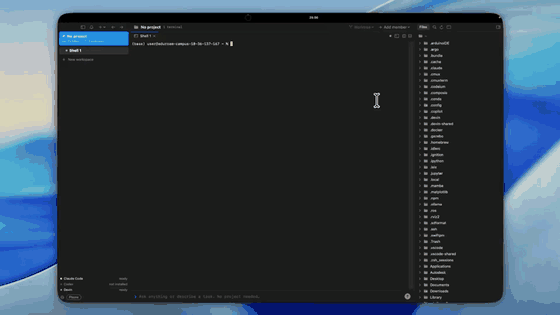

# Argo

Your AI coding team on Mac. Give it one high-level task; it plans the work, routes each
subtask to the coding CLI and model that suits it, runs independent subtasks in parallel in isolated
git worktrees, merges, checks, reviews and reports. Check on it, or redirect it, from your phone's browser.

## Demo

[](web/public/media/argo.mp4)

▶ [Watch the full video](web/public/media/argo.mp4) (1 min 54 s, the same film shown on the website)

```
mac/            Native macOS app (SwiftUI, cmux-style: vertical run tabs, split agent panes, notification rings)
orchestrator/   Local daemon (Node, zero dependencies): planning, routing, worktrees, shared record
web/            Wasp app: landing page + phone console (start tasks, send follow-ups, approve plans)
```

## Run it

Requirements: macOS 14+, Node 24+, git, and at least one of `claude`, `codex`, `devin` on your PATH.

```sh
mac/build.sh && open mac/build/Argo.app      # starts the orchestrator itself
```

Choose a project folder (a git repository), type a task, review the plan, click any agent label to
override the agent, model or reasoning level for that subtask, then **Approve & run**.

**Settings** also has the appearance (System, Light or Dark) and **Check for Updates**, which compares the
installed version with the latest GitHub release and offers the DMG for this Mac when a newer one exists.

Phone:

```sh
npm i -g @wasp.sh/wasp-cli@0.26.1
cd web && wasp install && wasp db migrate-dev
./tunnel.sh          # needs cloudflared, or Tailscale running; prints the phone address
./dev.sh             # or: local only, http://localhost:4318
```

On the phone: open the address and go to /app. There is no login: anyone who can reach the address can
control your agents, so keep it on localhost or a private network (Tailscale).

## How it works

- **Orchestration.** The lead CLI produces a plan (subtasks, dependencies, an agent/model/reasoning
  choice with a reason for each). Subtasks whose dependencies are met run concurrently, up to the
  parallel limit. Each finished subtask is committed and merged into the run's integration branch
  `argo/<run>/main`; if a merge conflicts, the agent that produced it is asked to resolve it.
  Then checks run (configured, or detected from the repo), a different agent reviews the result, and
  the report lists what is done and what still needs you. Nothing touches your checkout until you
  click **Merge into <branch>**.
- **Shared record.** `<project>/.argo/` holds `state.json` and `MEMORY.md`: goal, constraints,
  follow-ups, decisions, each subtask's status, agent, model and changed files. Every agent gets it in
  its prompt and can re-read the live file; agents record decisions in `.argo/notes/`, which the
  orchestrator folds into the record. The directory is excluded via `.git/info/exclude`.
- **Staying current.** A teammate may have pushed since you last pulled. A run fetches and merges the newest
  remote commits into its integration branch before it plans, again before the checks, and once more when
  you click Merge (a conflict goes to the lead agent; your own checkout is never touched). The
  **Worktree** button opens Claude, Codex, Devin or a shell in a fresh worktree (`argo/wt/<name>`) started
  from the latest remote code, or puts another agent into an existing one. Each worktree tracks the remote
  branch; the app checks the remote every minute, shows "N behind" on that worktree's panes, and
  **Pull latest** merges new pushes in without losing an agent's uncommitted work.
- **Model controls.** Settings: default CLI (or Auto), a model per CLI, reasoning level, parallelism,
  whether plans need approval. Per-subtask override from the pane header. Every pane, the record and
  the phone show which agent and model did the work and whether it was an override.
- **Attention.** A failed agent, a blocked command, four minutes of silence, a merge conflict or a
  finished run raises a notification (blue ring and macOS notification).
  A follow-up while a subtask is blocked goes to that subtask ("approve" lets a blocked command run);
  otherwise it becomes a new subtask on the run.

## Tests

```sh
cd orchestrator && npm test     # scripted agent: planning, parallelism, isolation, override, follow-up, failure + retry
cd web && wasp compile
```

## Packaging a release

```sh
mac/package.sh 0.1.3      # builds, then writes mac/dist/Argo-0.1.3-arm64.zip, .dmg and SHA256SUMS.txt
```

The app is ad-hoc signed, not notarized, so on another Mac the first launch needs right-click → Open
(or `xattr -dr com.apple.quarantine /Applications/Argo.app`). It is built for the architecture of the
Mac that packages it, and needs Node 24+ and at least one coding CLI on the user's PATH.

Publish it as a GitHub release on the tag `v<version>` with the DMG attached under the name `package.sh`
gives it: **Check for Updates** in the app reads the latest release, and the website's download link
expects that file name.
